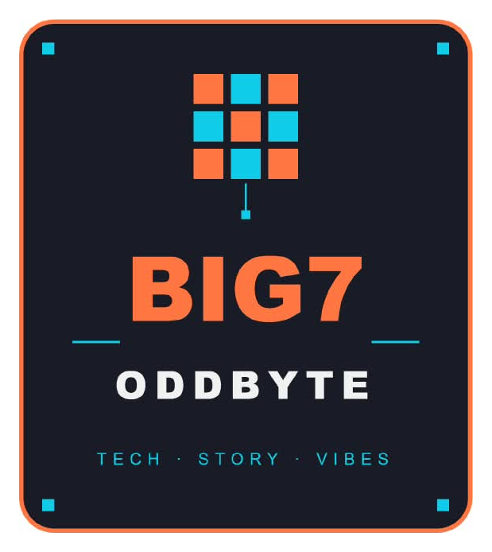
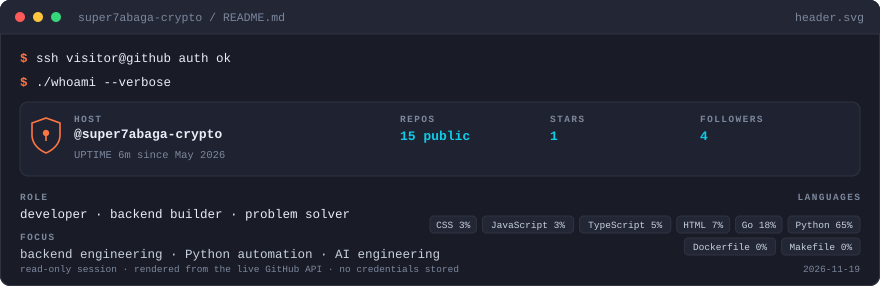
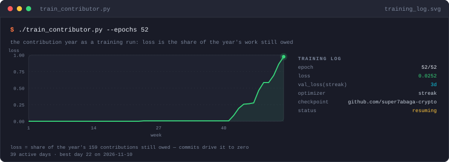
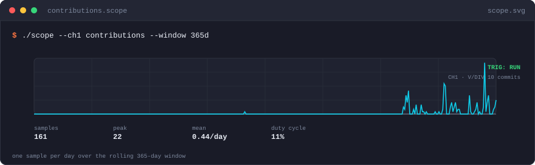
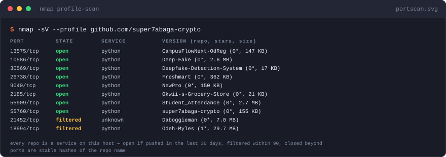
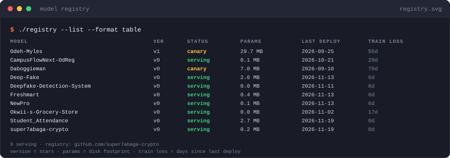
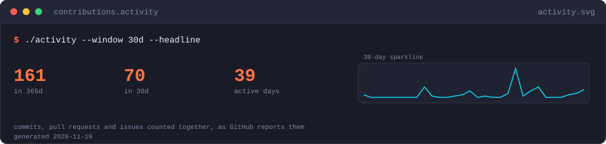
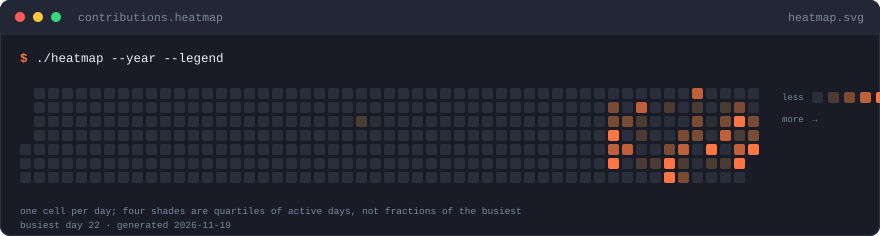
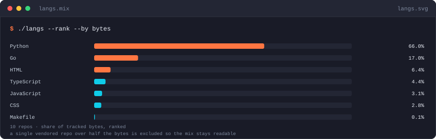

  

  

  <em>Fifteen seconds of terminal instead of a paragraph about myself.</em>

  I build with <strong>Python, JavaScript and clean, thoughtful code</strong> — learning in public,
  one project at a time.

  <a href="https://github.com/super7abaga-crypto?tab=repositories">repos</a>
  &nbsp;·&nbsp; <a href="mailto:super7abaga@gmail.com">email</a>

---

## Training log

One sample per week. Loss is the share of the year's contributions still owed, so the
curve only converges when I actually ship. The marker sits at the current week.

## Recon

Every repo is a service on this host: **open** if pushed in the last 30 days,
**filtered** within 90, **closed** beyond that. Ports are stable hashes of the repo
name. The registry frames the same repos as models — version is stars, params is disk
footprint, train loss is days since the last deploy.

## GitHub analytics

## About me

- 🔭 **Currently building:** a deepfake multimedia detection system — image, video and
  audio classification served over FastAPI, with measured accuracy rather than claimed
  accuracy. It is my final-year project.
- 🌱 **Currently deepening:** Python fundamentals, backend and API design, and AI
  engineering from the ground up.
- 🧩 **Core stack:** Python, FastAPI, JavaScript, SQLite, Docker, Linux, Git.
- 💬 **Ask me about:** building tools for campus and community use, or turning an idea
  into a working product one small project at a time.

## Featured projects

| Project | What it is |
|---|---|
| **[Deep-Fake](https://github.com/super7abaga-crypto/Deep-Fake)** | Final-year project. Upload an image, video or audio file; an ensemble of ViT and SigLIP detectors classifies it DEEPFAKE, SUSPICIOUS or AUTHENTIC, and explains the evidence. 0.961 AUC on 59 labelled files. |
| **[Freshmart](https://github.com/super7abaga-crypto/Freshmart)** | Okwuii's Grocery Store — a grocery delivery app that renders its own pages, deployed on Render. [Live demo](https://freshmart-j97h.onrender.com). |
| **[Student_Attendance](https://github.com/super7abaga-crypto/Student_Attendance)** | LEARN 2EARN student attendance portal: registration, sign-in, attendance record and QR check-in against the mentor's displayed code. |
| **[CampusFlowNext-OdReg](https://github.com/super7abaga-crypto/CampusFlowNext-OdReg)** | Command-line ticket management for campus IT support — priority scoring, specialist assignment, workload tracking and progress notes. |
| **[Okwii-s-Grocery-Store](https://github.com/super7abaga-crypto/Okwii-s-Grocery-Store)** | Grocery store application with a Python FastAPI backend (models, schemas, security) and an HTML, CSS and JavaScript storefront. |
| **[NewPro](https://github.com/super7abaga-crypto/NewPro)** | Two Python builds: Mystery-Island, a text-based game with its own test suite, and TournamentLab, a fixtures and standings tool. |
| **[Odeh-Myles](https://github.com/super7abaga-crypto/Odeh-Myles)** | Fundamentals practice: a number guessing game, a binary-search guessing game, and a cryptographically secure password generator. |

## Tech stack

  
  
  
  
  
  
  
  

---

**LEARNING IN PUBLIC.**
**BUILDING REAL PROJECTS.**
**SHIPPING WHAT I LEARN.**

 

*Always learning. Always building. Thanks for stopping by!* 🚀

© 2026 Odeh

Every card above is drawn by <a href="cards/generate.py"><code>cards/generate.py</code></a>
from the live GitHub API and committed back to this branch daily by
<a href=".github/workflows/cards.yml"><code>cards.yml</code></a> — no third-party
widget services, so nothing here can go blank when someone else's free tier expires.

