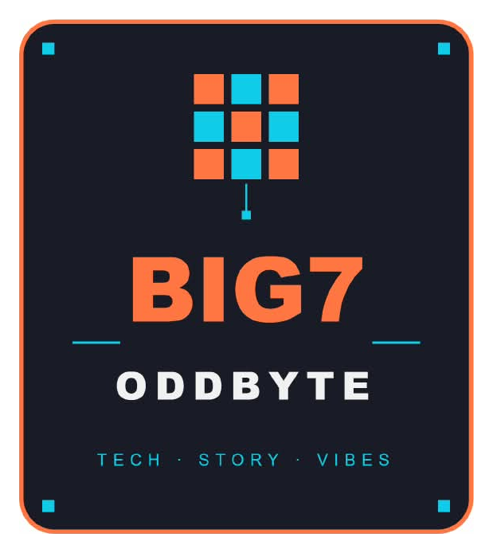

I'm a developer learning in public, building real projects with **Python, JavaScript, and clean, thoughtful code** that solves problems I actually run into.

My focus is on getting the fundamentals right, then turning them into things that are **useful, reliable, and easy to use**.

## 🚀 What I’m Into
- Software development
- Building backends and APIs
- Web development with JavaScript, HTML and CSS
- Learning new technologies through project-based practice
- Python programming and automation
- AI engineering and building AI-powered applications
- Turning ideas into working products, one small project at a time

## 🛠️ Tech Stack

### Languages

### Frontend

### Backend

### Databases & Tools

## 📈 Live Activity

## 🌱 Current Focus

I'm currently focused on:

- Strengthening my Python fundamentals
- Backend development and API design
- Writing tested, reliable code
- Building tools for campus and community use
- Learning AI engineering from the ground up

## 🧩 Featured Projects

### 1. [CampusFlowNext-OdReg](https://github.com/super7abaga-crypto/CampusFlowNext-OdReg)

A command-line ticket management system for campus IT support, with priority scoring, specialist assignment, workload tracking and progress notes.

### 2. [Okwii-s-Grocery-Store](https://github.com/super7abaga-crypto/Okwii-s-Grocery-Store)

A grocery store application with a Python FastAPI backend (database models, schemas, security) and an HTML, CSS and JavaScript storefront.

### 3. [Freshmart](https://github.com/super7abaga-crypto/Freshmart)

A full-stack grocery app with a Node.js/Express backend (auth, products, orders, file and PostgreSQL data layers) and a lightweight frontend, ready to deploy on Render.

### 4. [Deepfake-Detection-System](https://github.com/super7abaga-crypto/Deepfake-Detection-System)

A Python backend for detecting manipulated images, organised into routes and service layers for clean, testable image handling.

### 5. [NewPro](https://github.com/super7abaga-crypto/NewPro)

A pair of Python builds: Mystery-Island, a text-based game with its own test suite and design notes, and TournamentLab, a tournament fixtures and standings tool.

### 6. [Odeh-Myles](https://github.com/super7abaga-crypto/Odeh-Myles)

Small Python scripts from my fundamentals practice: a number guessing game, a binary-search version where the computer guesses your number, and a cryptographically secure password generator.

## 🔗 Connect With Me

- GitHub: [super7abaga-crypto](https://github.com/super7abaga-crypto)
- LinkedIn: [Add your profile](https://www.linkedin.com/)
- Portfolio: [Add your site](https://github.com/super7abaga-crypto?tab=repositories)
- Email: super7abaga@gmail.com

## ✨ Closing Note

**LEARNING IN PUBLIC.**
**BUILDING REAL PROJECTS.**
**SHIPPING WHAT I LEARN.**

 

*Always learning. Always building. Thanks for stopping by!* 🚀

© 2026 Odeh

